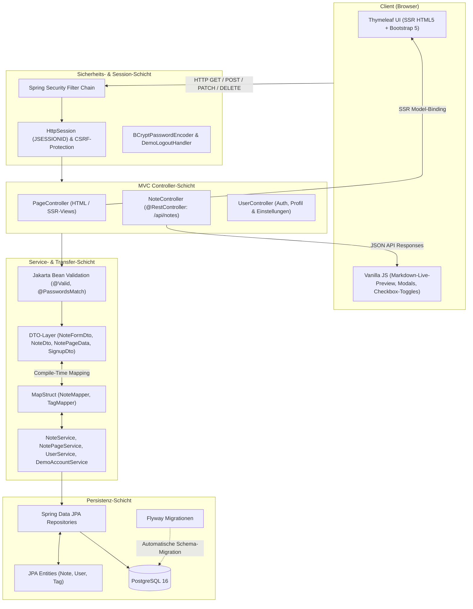
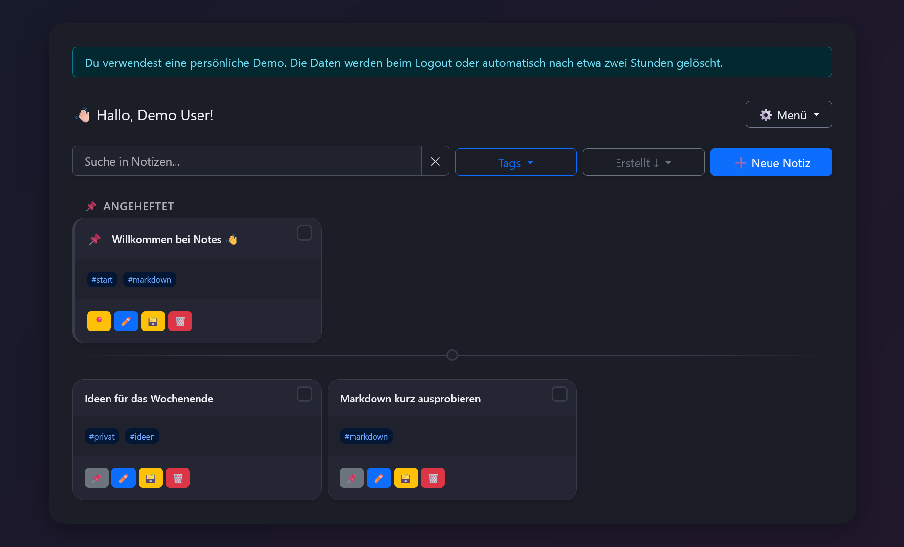

# Notes

[](https://openjdk.org/)
[](https://spring.io/projects/spring-boot)
[](https://www.thymeleaf.org/)
[](https://www.postgresql.org/)
[](https://www.docker.com/)
[](https://notes-web-qwo2.onrender.com)

Eine responsive Webanwendung zum Erstellen, Verwalten und Strukturieren persönlicher Notizen. **Notes** kombiniert ein serverseitig gerendertes Spring-Boot-Backend mit Thymeleaf, Markdown-Unterstützung mit interaktiven Aufgabenlisten, Tag-Verwaltung, Volltextsuche sowie Archiv- und Papierkorb-Funktionen.

---

<p align="center">
  
</p>

> **Thymeleaf-basierte Benutzeroberfläche**: Serverseitig gerendertes Dashboard im Google-Keep-Stil mit dynamischer Markdown-Vorschau, Tag-Filtern, Suchleiste und interaktiven Notizkarten.

---

## Live-Demo

Die Anwendung kann direkt im Browser getestet werden – ohne lokale Installation oder Einrichtung:

### [Notes-Webanwendung öffnen →](https://notes-web-qwo2.onrender.com)

*Tipp:* Über die Schaltfläche **„Demo ausprobieren“** auf der Login-Seite wird sofort ein isolierter Gast-Zugang mit vorgefertigten Beispielnotizen erstellt. Die Daten werden beim Logout oder nach Inaktivität automatisch bereinigt.

---

## Architektur & Designmuster

Notes folgt einer sauberen, mehrschichtigen **Model-View-Controller (MVC)**-Architektur. Das Frontend setzt auf performantes **Server-Side Rendering (SSR)** mit Thymeleaf, strikte Entkopplung über **Data Transfer Objects (DTOs)** und eine sichere **Session-basierte Authentifizierung** via Spring Security.



### 1. Model-View-Controller (MVC)
Die Anwendungsarchitektur trennt Präsentation, Ablaufsteuerung und Domänenlogik strikt voneinander:
- **Model**: Kapselt Daten und Geschäftsregeln. Intern arbeiten Services und Repositories mit relationalen JPA-Entitäten (`Note`, `User`, `Tag`). Für die Darstellung im Frontend übergibt der Controller typisierte Datenmodelle (`NotePageData`, `NoteFormDto`) über das Spring `Model`-Interface an die Rendering-Engine.
- **View**: Thymeleaf-Templates (`notes.html`, `note-view.html`, `archive.html`, `trash.html`, `settings.html`, `login.html`) interpretieren das Model und generieren standardkonformes HTML5.
- **Controller**:
  - `PageController`: Behandelt Navigation und Seitenabrufe (`/notes`, `/notes/archive`, `/notes/trash`, `/notes/new`, `/notes/{id}`). Er steuert Filter, Paginierung sowie Sortierung und liefert die fertigen HTML-Views zurück.
  - `NoteController`: Stellt REST-Endpunkte unter `/api/notes` für asynchrone clientseitige Operationen bereit (z. B. Task-Checkboxen in Markdown abhaken, Notiz anheften, Statusänderungen).
  - `UserController`: Steuert Authentifizierungs- und Benutzerverwaltungs-Workflows (Registrierung, Anzeigename ändern, Passwortwechsel, Kontolöschung).

### 2. Server-Side Rendering (SSR) mit Thymeleaf
Die Oberfläche wird vollständig serverseitig mit Thymeleaf gerendert:
- **Schnelle Ladezeiten (Fast FCP)**: Der Browser empfängt vollständiges, semantisches HTML direkt vom Server. Es entfällt das Herunterladen und Ausführen großer Single-Page-Application-Bundles vor dem ersten Rendering.
- **Direkte Framework-Integration**: Thymeleaf integriert sich nahtlos mit Spring MVC und Spring Security (`thymeleaf-extras-springsecurity6`). Sicherheitsrelevante Prüfungen oder rollenbasierte UI-Elemente (z. B. das Demo-Hinweisbanner via `th:if="${demoAccount}"`) werden zuverlässig auf dem Server entschieden.
- **Progressive Enhancement**: Die serverseitig erzeugte Seite wird gezielt durch modulare JavaScript-Komponenten (`/js/notes.js`, `/js/markdown-preview.js`, `/js/note-preview.js`) ergänzt:
  - Dynamischer Markdown-Parser mit synchronisierter Live-Vorschau im Editor.
  - Interaktives Abhaken von Markdown-Aufgaben (`[ ]` / `[x]`) direkt aus der Karten- und Detailansicht über asynchrone `fetch`-Aufrufe an die REST-Endpunkte.
  - Schnelle modale Detailansichten ohne vollständigen Neuladen der Seite.

### 3. Data Transfer Objects (DTOs) & Validierung
Um Sicherheitsrisiken und Architekturverletzungen zu vermeiden, werden Persistenzentitäten strikt von den äußeren Schnittstellen isoliert:
- **Schutz vor Over-Posting & Mass Assignment**: JPA-Entitäten werden weder als `@RequestBody` akzeptiert noch direkt an Views exponiert. Sensible Attribute (z. B. Passwort-Hashes, Löschflags, Mandanten-Zuordnungen) bleiben vor Manipulationen geschützt.
- **Spezifische DTOs**:
  - `NoteFormDto`: Validiertes Eingabemodell für das Erstellen und Bearbeiten von Notizen (Validierung von Titellänge, Inhaltsgröße und maximaler Tag-Anzahl).
  - `NoteDto`: Lesemodell für API-Antworten mit formatierten Daten und einer serverseitig generierten Textvorschau (`contentPreview`).
  - `NotePageData` & `NotePageRequest`: Kapseln Suchfilter, Sortierparameter, Tag-Selektion und Paginierungsinformationen.
  - `SignupDto`, `NameUpdateDto`, `PasswordUpdateDto`, `DeleteAccountDto`: Spezialisierte Datentransferobjekte für Kontofunktionen.
- **Typsicheres Mapping mit MapStruct**: `NoteMapper` und `TagMapper` generieren zur Kompilierzeit performanten Mapping-Code zwischen Entitäten und DTOs. Dies eliminiert fehleranfälliges manuelles Kopieren und vermeidet den Laufzeit-Overhead von Reflection-basierten Mappern.
- **Deklarative Validierung**: Sämtliche Eingaben werden auf DTO-Ebene mit Jakarta Bean Validation (`@Valid`, `@NotBlank`, `@Size`, `@NotNull`) sowie benutzerdefinierten Validatoren (`@PasswordsMatch`) geprüft. Validierungsfehler werden direkt an die Formulare zurückgemeldet (`#fields.hasErrors()`).

### 4. Session-basierte Authentifizierung (Session-Auth)
Die Benutzerauthentifizierung basiert auf dem bewährten zustandsbehafteten Session-Modell von Spring Security:
- **Session-Lifecycle**: Nach erfolgreicher Anmeldung am Form-Login (`/login`) initialisiert Spring Security den `SecurityContext` und hinterlegt ihn in der HTTP-Session (`HttpSessionSecurityContextRepository`). Der Client identifiziert sich über ein sicheres `JSESSIONID`-Cookie.
- **Sichere Passwort-Speicherung**: Passwörter werden vor dem Speichern in der PostgreSQL-Datenbank mit `BCryptPasswordEncoder` und individuellen Salts kryptografisch gehasht.
- **CSRF-Schutz**: Vollständig aktivierter Cross-Site-Request-Forgery-Schutz für alle zustandsverändernden HTTP-Methoden (`POST`, `PATCH`, `DELETE`). Thymeleaf bindet CSRF-Tokens automatisch als versteckte Eingabefelder in HTML-Formulare ein. Für JavaScript-`fetch`-Requests stehen die Tokens über HTML-`<meta>`-Tags bereit.
- **Gäste- und Demo-System**: Über eine dedizierte `ROLE_DEMO` können Besucher die Anwendung sofort ausprobieren. Ein maßgeschneiderter `DemoLogoutHandler` und serverseitige Cleanup-Tasks stellen sicher, dass temporäre Demo-Konten und Notizen bei Session-Ende oder Zeitablauf rückstandsfrei aus der Datenbank entfernt werden.

---

## Funktionen

- **Notiz-Organisation**: Notizen erstellen, bearbeiten, anheften, archivieren oder in den Papierkorb verschieben.
- **Markdown-Editor & Live-Vorschau**: Vollwertige Markdown-Formatierung mit Split-View-Vorschau in Echtzeit.
- **Interaktive Aufgabenlisten**: Checkboxen (`- [ ]` / `- [x]`) können direkt in der Vorschau per Mausklick abgehakt werden.
- **Tag-System**: Flexible Kategorisierung mit bis zu 10 Tags pro Notiz inklusive Tag-Filtern und Autovervollständigung.
- **Volltextsuche & Sortierung**: Notizen nach Titel und Inhalt durchsuchen sowie nach Erstelldatum, Änderungsdatum oder Titel sortieren.
- **Mehrfachauswahl (Batch-Aktionen)**: Mehrere Notizen gleichzeitig auswählen, um sie gesammelt zu archivieren oder zu löschen.
- **Konto & Sicherheit**: E-Mail-Registrierung, Passwortänderung, Dark/Light-Theme-Umschaltung und Account-Löschung.
- **Automatisierte Demo**: Ein-Klick-Demo-Zugang für Gäste ohne Registrierungshürde.

---

## Tech-Stack

| Bereich | Technologie | Beschreibung |
|---|---|---|
| **Sprache** | Java 21 (LTS) | Modernes Java mit Records, Pattern Matching und Virtual Threads Readiness |
| **Framework** | Spring Boot 3.5.15 | Backend-Fundament, Dependency Injection, Auto-Configuration, Actuator |
| **Frontend** | Thymeleaf 3 & Bootstrap 5.3.8 | Serverseitige HTML-Templates, responsive Komponenten, Vanilla JS (ES6) |
| **Sicherheit** | Spring Security 6 | Session-basierte Authentifizierung, Form-Login, BCrypt, CSRF-Schutz |
| **Datenbank** | PostgreSQL 16 & Flyway | Relationale Speicherung, automatisierte versionierte Schemamigrationen |
| **ORM & Mapping** | Spring Data JPA, Hibernate, MapStruct | Deklarative Datenzugriffsschicht, Compile-Time DTO-Mapping, Lombok |
| **Testing** | JUnit 5, MockMvc, Testcontainers, H2 | Unit-, MVC-, Repository- und containerisierte Integrations-Tests |
| **DevOps** | Docker, Docker Compose, Render | Multi-Stage Distroless Docker Build, Cloud-Hosting auf Render |

---

## Screenshots

| Notizübersicht (Thymeleaf UI) | Markdown-Editor & Live-Vorschau |
|:---:|:---:|
|  |  |

| Mehrfachauswahl & Aktionen | Interaktives Detail-Modal |
|:---:|:---:|
|  |  |

| Login mit Demo-Zugang | Dark-Mode-Ansicht |
|:---:|:---:|
|  |  |

*Weitere Bildschirmfotos (Archiv, Papierkorb, Einstellungen, Registrierung) befinden sich unter [`docs/screenshots`](docs/screenshots).*

---

## Lokale Installation & Ausführung

### Schnellstart mit Docker Compose
Voraussetzung: Installiertes [Docker Desktop](https://www.docker.com/) inklusive Docker Compose.

```bash
docker compose up --build
```

Anschließend ist die Anwendung im Browser erreichbar unter:
👉 **[http://localhost:8080](http://localhost:8080)**

Container und Ressourcen beenden:
```bash
docker compose down
```
*(Die Datenbankdaten bleiben im Docker-Volume `postgres_data` persistent erhalten).*

---

### Lokale Entwicklung mit Maven
Benötigt werden ein installiertes **JDK 21** und eine lokale Docker-Instanz für PostgreSQL.

1. **PostgreSQL-Container starten:**
   ```bash
   docker compose up -d postgres
   ```
   *(PostgreSQL läuft lokal auf Port `5433`).*

2. **Anwendung mit dem Entwicklungsprofil (`dev`) starten:**

   **PowerShell (Windows):**
   ```powershell
   $env:SPRING_PROFILES_ACTIVE = "dev"
   .\mvnw.cmd spring-boot:run
   ```

   **Bash (macOS / Linux):**
   ```bash
   SPRING_PROFILES_ACTIVE=dev ./mvnw spring-boot:run
   ```

Beim Start wendet Flyway alle noch ausstehenden Datenbankmigrationen automatisch an.

---

## Tests & Qualitätssicherung

Die Testsuite deckt Unit-, Web-MVC-, Repository- und End-to-End-Szenarien ab:
- **Schnelle Modultests:** Verwenden eine In-Memory-H2-Datenbank und benötigen keine externe Infrastruktur.
- **Containerisierte Integrationstests:** Testcontainers startet bei vorhandener Docker-Umgebung eine reale PostgreSQL-16-Instanz, führt alle Flyway-Migrationen aus und validiert das Hibernate-Schema. Fehlt Docker, wird dieser Test automatisch übersprungen.

**Tests ausführen:**

PowerShell:
```powershell
.\mvnw.cmd test
```

macOS / Linux:
```bash
./mvnw test
```

---

## Konfiguration & Profile

Die Anwendung nutzt Spring-Profile zur Umgebungssteuerung:

| Profil | Einsatzbereich | Datenbank-Konfiguration |
|---|---|---|
| `dev` | Lokale Entwicklung | PostgreSQL (`localhost:5433`), überschreibbare Defaults |
| `test` | Automatisierte Testsuite | H2 In-Memory-Datenbank |
| `prod` | Produktivbetrieb (z. B. Render) | PostgreSQL via Umgebungsvariablen |

### Umgebungsvariablen (Produktion)
Im `prod`-Profil müssen folgende Umgebungsvariablen gesetzt werden (Vorlage siehe [`.env.example`](.env.example)):

| Variable | Beschreibung |
|---|---|
| `DB_URL` | JDBC-Verbindungs-URL (z. B. `jdbc:postgresql://host:5432/notes`) |
| `DB_USERNAME` | Benutzername der PostgreSQL-Datenbank |
| `DB_PASSWORD` | Passwort des Datenbankbenutzers |

### Parameter für temporäre Demo-Konten (optional)

| Variable | Standardwert | Beschreibung |
|---|---|---|
| `DEMO_ACCOUNT_LIFETIME` | `PT2H` (2 Stunden) | Gültigkeitsdauer eines Gast-Accounts (ISO-8601 Dauer) |
| `DEMO_CLEANUP_INTERVAL` | `PT15M` (15 Min.) | Intervall für den Hintergrund-Cleanup abgelaufener Demos |
| `DEMO_MAX_ACCOUNTS` | `50` | Maximale Anzahl zeitgleich aktiver Demo-Konten |

---

## Projektstruktur

```text
src/
├── main/
│   ├── java/com/melina/notes/
│   │   ├── controller/      # MVC- (PageController) & REST-Controller (NoteController)
│   │   ├── service/         # Geschäftslogik & Paginierungsdienste
│   │   ├── repository/      # Spring Data JPA Repositories
│   │   ├── entity/          # Relationale JPA-Entitäten (Note, User, Tag)
│   │   ├── dto/             # Data Transfer Objects (Form-, View- & Auth-DTOs)
│   │   ├── mapper/          # MapStruct-Mapper (NoteMapper, TagMapper)
│   │   ├── security/        # Spring Security Config, UserDetails, LogoutHandler
│   │   ├── validation/      # Benutzerdefinierte Validatoren (@PasswordsMatch)
│   │   ├── filter/          # JPA Specifications für Notiz-Filter
│   │   ├── exception/       # Domänenspezifische Exceptions & GlobalExceptionHandler
│   │   └── util/            # Hilfsklassen (z. B. ContentPreviewUtil)
│   └── resources/
│       ├── db/migration/    # Versionierte Flyway-SQL-Migrationen (V1..V8)
│       ├── static/          # CSS, JavaScript (ES6-Module), WebJars & Assets
│       └── templates/       # Serverseitige Thymeleaf-Templates (HTML5)
└── test/                    # Unit-, MVC-, Security-, Repo- & Testcontainers-Tests
```

---

## Build

Ein ausführbares Produktions-JAR lässt sich über den Maven Wrapper erzeugen:

```powershell
.\mvnw.cmd clean package
```

Das Multi-Stage [`Dockerfile`](Dockerfile) kompiliert den Quellcode in einer isolierten Maven-Build-Stage und führt das Artefakt anschließend in einem schlanken Distroless-Image (`gcr.io/distroless/java21-debian12`) aus.
