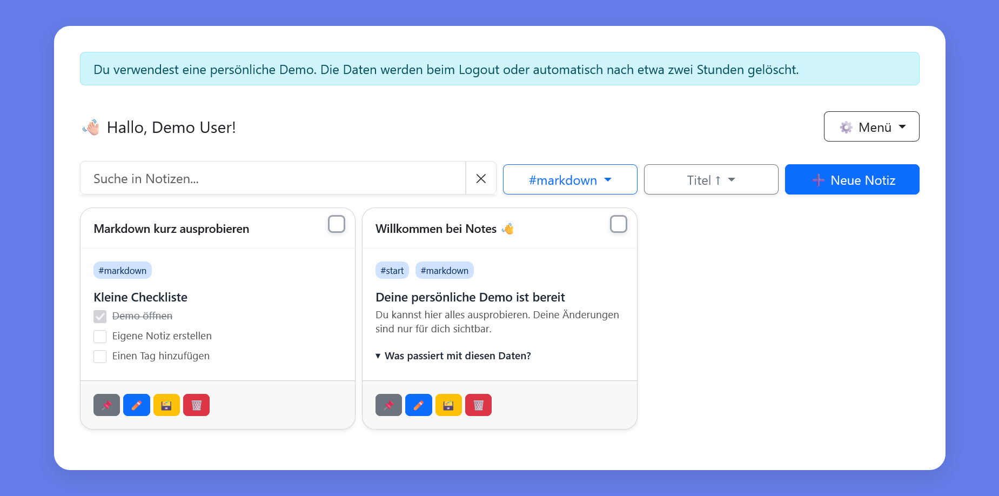
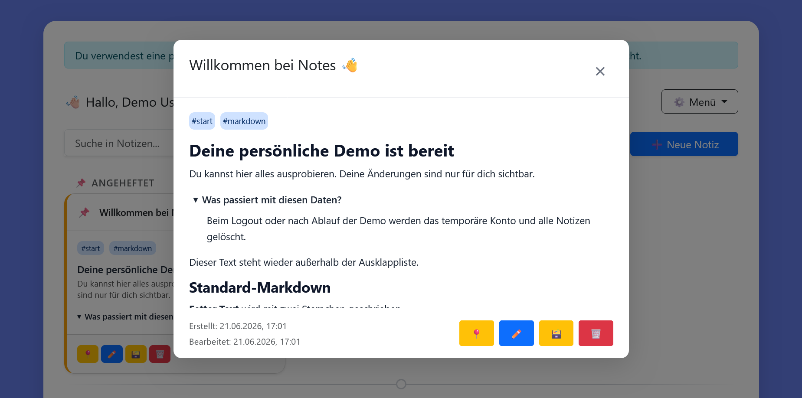
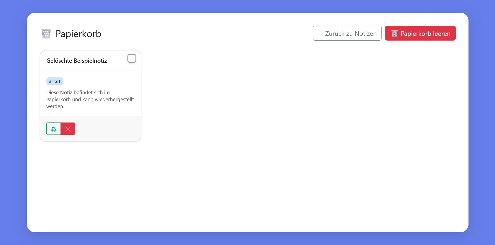
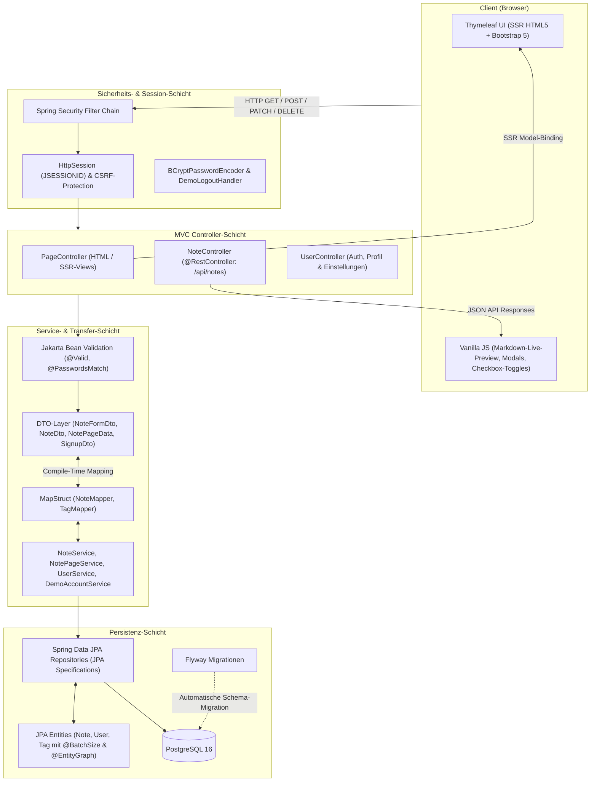

# Notes – Persönliches Notiz- & Wissensmanagement

[](https://openjdk.org/)
[](https://spring.io/projects/spring-boot)
[](https://www.thymeleaf.org/)
[](https://www.postgresql.org/)
[](https://spring.io/projects/spring-security)
[](https://www.docker.com/)
[](https://notes-web-qwo2.onrender.com)

Eine produktive, responsive Webanwendung zum Erfassen, Strukturieren und Durchsuchen persönlicher Notizen und Aufgaben. **Notes** setzt auf performantes **Server-Side Rendering (SSR)** mit **Spring Boot 3.5** und **Thymeleaf**, einen **Markdown-Editor mit synchronisierter Live-Vorschau**, interaktive Aufgabenlisten, flexible Tag-Filter, dynamische JPA-Abfragen sowie eine isolierte, sichere 1-Klick-Gastdemo.

---

<p align="center">
  
</p>

> **Dashboard-Übersicht im Google-Keep-Stil**: Serverseitig gerenderte Notizkarten mit Formatierungsvorschau, Tag-Pills, Sofort-Aktionen (Anheften, Archivieren, Löschen), Sidebar-Navigation und Volltextsuche.

---

## 🎯 Fokus & Abgrenzung zu ProjectFlow

Während **ProjectFlow** ein komplexes, kollaboratives Projektmanagement-System für Teams mit Kanban-Boards, Ticket-Workflows und REST/SPA-Architektur darstellt, setzt **Notes** einen ganz anderen, bewusst gewählten Schwerpunkt:

| Merkmal | Notes (dieses Projekt) | ProjectFlow |
|---|---|---|
| **Einsatzzweck** | Persönliches Notiz- & Wissensmanagement (Privacy-First) | Team-Kollaboration & Multi-User-Projektsteuerung |
| **Architektur** | **Server-Side Rendering (SSR)** mit Spring Boot & Thymeleaf | RESTful Web Services & SPA-Frontend |
| **Frontend-Stack** | Thymeleaf 3, Bootstrap 5 & Vanilla JS (Progressive Enhancement) | Dynamisches Client-Rendering / SPA |
| **Notiz-/Textformat** | **Markdown mit Live-Vorschau** & interaktivem Aufgaben-Abhaken | Strukturierte Tickets, Boards & Status-Pipelines |
| **Datenzugriff** | Dynamische **JPA Specifications**, Batch-Fetching & EntityGraphs | Relationals CRUD & domänenspezifische Projekt-Relationen |
| **Authentifizierung** | Zustandsbehaftete **Session-Auth (JSESSIONID)** mit CSRF-Tokens | Token- / Stateless- oder zustandslose Auth-Workflows |
| **Demo-Zugang** | **1-Klick-Gastdemo** mit automatischer, robuster Bereinigung | Mehrstufige Testbenutzer / Team-Mock-Konten |

**Notes** beweist, wie sich mit modernem Java 21, Spring Boot und serverseitigem Rendering eine extrem reaktionsschnelle, leichtgewichtige und sichere Webanwendung ohne den Overhead schwerfälliger JavaScript-Frameworks realisieren lässt.

---

## 🌐 Live-Demo & bekannte Rahmenbedingungen

Die Anwendung ist live auf Render verfügbar und kann direkt im Browser getestet werden:

### 🚀 [Notes Live-Demo öffnen →](https://notes-web-qwo2.onrender.com)

- **1-Klick-Gastzugang**: Auf der Login-Seite genügt ein Klick auf **„Demo ausprobieren“**. Es wird sofort ein isoliertes Gastkonto mit vorgefertigten Beispieldaten erzeugt – ganz ohne Registrierungsformular oder Passworteingabe.
- **Automatische Bereinigung**: Die Daten des Gastkontos werden beim Logout oder zeitgesteuert nach Inaktivität rückstandsfrei entfernt.

> [!NOTE]
> **Bekannte Einschränkungen der Live-Demo (Render Free Tier):**
> 1. **Kaltstart (Cold Start):** Da der Dienst auf dem kostenlosen Tier von Render gehostet wird, fährt der Container bei längerer Inaktivität in den Ruhezustand (Spin-down). Der erste Aufruf kann daher ca. **30–50 Sekunden** dauern, während JVM und PostgreSQL hochfahren. Nachfolgende Anfragen reagieren gewohnt schnell.
> 2. **Flüchtige Demo-Daten:** Gast-Accounts (`ROLE_DEMO`) haben eine maximale Lebensdauer von **2 Stunden** und werden danach automatisch bereinigt. Für permanente Speicherung steht die reguläre Registrierung zur Verfügung.
> 3. **Kapazitätslimit:** Zum Schutz vor Ressourcenerschöpfung sind zeitgleich maximal **50 aktive Demo-Accounts** zulässig.

---

## 🧭 Typischer Ablauf: Von der Anmeldung bis zur Notizsuche

Der typische Arbeitsablauf in Notes führt in wenigen intuitiven Schritten vom Login zur organisierten Notiz:

### 1. Zugang wählen (Demo oder Registrierung)
Auf der Login-Seite (`/login`) kann entweder sofort die **1-Klick-Demo** gestartet oder über die Registrierungsseite (`/signup`) ein permanentes Benutzerkonto mit E-Mail-Adresse und Passwort angelegt werden.

<p align="center">
  
</p>

---

### 2. Notiz erfassen & Markdown-Editor
Über **„+ Neue Notiz“** öffnet sich der Editor (`/notes/new` bzw. `/notes/{id}`). Neben dem Titel können Markdown-Formatierungen (Überschriften, Listen, Code-Blöcke, Aufgaben) genutzt werden.
- **Echtzeit-Live-Vorschau**: Der Editor bietet eine zuschaltbare Split-Screen-Vorschau, die Änderungen im Markdown-Text ohne Server-Roundtrip synchron darstellt.
- **Tag-Zuweisung**: Bis zu 10 Tags können per Komma oder Tab vergeben werden, um Notizen thematisch zu gruppieren.

<p align="center">
  
</p>

---

### 3. Suchen, Filtern & Tag-Navigation
In der Hauptübersicht (`/notes`) stehen leistungsfähige Filter bereit:
- **Volltextsuche**: Die Suchleiste filtert in Echtzeit über Titel und Inhalt.
- **Tag-Filterung**: Ein Klick auf ein Tag in der linken Navigationsleiste isoliert alle zugehörigen Notizen.
- **Sortierung & Paginierung**: Notizen können nach Erstelldatum, Aktualisierungsdatum oder Titel (auf- oder absteigend) sortiert werden; angeheftete Notizen bleiben stets oben.

<p align="center">
  
</p>

---

### 4. Interaktive Detailansicht & Aufgaben abhaken
Ein Klick auf eine Notizkarte öffnet das interaktive Detail-Modal:
- Aufgabenlisten im Markdown-Format (`- [ ]` / `- [x]`) können **direkt per Klick abgehakt werden**, ohne den Editor öffnen zu müssen.
- Der Status wird asynchron im Hintergrund per API aktualisiert und in der Datenbank persistiert.

<p align="center">
  
</p>

---

### 5. Organisation: Mehrfachauswahl, Archiv & Papierkorb
- **Batch-Aktionen**: Über die Mehrfachauswahl lassen sich mehrere Notizen markieren und gesammelt archivieren oder in den Papierkorb verschieben.
- **Archiv (`/notes/archive`)**: Behält wichtige Notizen griffbereit, ohne die aktive Übersicht zu überladen.
- **Papierkorb (`/notes/trash`)**: 2-stufiger Löschschutz – gelöschte Notizen können jederzeit wiederhergestellt oder endgültig vernichtet werden.

<p align="center">
  
  &nbsp;&nbsp;
  
</p>

---

## ⚡ Technische Highlights & Deep Dives

### 1. Robuste Sicherheitsarchitektur & strikte Mandantentrennung
Sicherheit und Datenschutz stehen im Kern der Anwendungslogik:
- **Strikte Datenisolation (Multi-Tenancy)**:
  Jede Lese-, Schreib-, Archivier- und Löschoperation wird auf Service- und Repository-Ebene zwingend an die ID des authentifizierten Benutzers gekoppelt (`findByIdAndUserId`, `findAllByUserIdAndDeleted`).
- **Schutz gegen IDOR & manipulierte IDs**:
  Versuche, fremde Notiz-IDs oder ungültige ID-Formate in URLs zu manipulieren, werden abgefangen und einheitlich mit HTTP 404 (`NoteNotFoundException`) bzw. HTTP 400 beantwortet, ohne interne Informationen preiszugeben.
- **Zustandsbehaftete Session-Auth & CSRF**:
  Spring Security schützt über `HttpSessionSecurityContextRepository` und sichere `JSESSIONID`-Cookies. Alle zustandsverändernden Requests (`POST`, `PATCH`, `DELETE`) sind durch synchrone CSRF-Tokens in Formularen und Meta-Tags für AJAX-Requests geschützt.
- **Kryptografisches Hashing**:
  Passwörter werden ausnahmslos mit `BCryptPasswordEncoder` und individuellem Salt gehasht.

### 2. Dynamische JPA Specifications & Query-Optimierung
Zur flexiblen Suche setzt Notes auf das Spring Data JPA Criteria-API (`Specification<Note>`):
- **Typsichere Kriterien-Pipeline**:
  `NoteSpecification.build(filter)` kombiniert Kriterien wie Benutzerzugehörigkeit, Suchbegriff, Tag-Filter, Löschflag und Archivstatus composable via `Specification.allOf()`.
- **SQL-Wildcard-Escaping**:
  Suchbegriffe werden automatisch gegen SQL-Injection und Wildcard-Nebeneffekte abgesichert: Sonderzeichen wie `%`, `_` und `\` werden in `NoteSpecification` maskiert (`escapeLikePattern`), sodass eine Suche nach `100%` tatsächlich nach dem Prozentzeichen sucht.
- **N+1-Vermeidung durch gezielte Fetch-Strategien**:
  - `@BatchSize(size = 50)` an `Note.tags`: Beim Laden von Notizübersichten mit bis zu 50 Einträgen holt Hibernate alle zugehörigen Tags in einer einzigen gebatchten Abfrage (`IN (?, ?, ...)`). Dadurch bleibt die relationale Datenbank-Paginierung (`LIMIT`/`OFFSET`) unberührt, ohne dass das berüchtigte N+1-Problem entsteht.
  - `@EntityGraph(attributePaths = {"tags"})` an `NoteRepository.findByIdAndUserId`: Beim Abruf einer Einzelnotiz werden die Tags sofort in einem einzigen `LEFT JOIN` mitgeladen.
- **Deterministische Paginierung**:
  `NotePageService` sichert Paginierungsstabilität durch einen sekundären ID-Tie-Breaker (`.and(Sort.by(sortDirection, "id"))`). Bei Notizen mit exakt gleichem Erstelldatum oder Titel wird so verhindert, dass Datensätze zwischen Seiten springen.

### 3. Resilienter Lebenszyklus temporärer Demo-Konten
Damit Portfolio-Besucher die Anwendung risikofrei testen können, besitzt Notes eine ausgereifte Demo-Verwaltung:
- **Thread-sichere Generierung**:
  `DemoAccountService.createDemoAccount()` ist synchronisiert und erzeugt Zufallsbenutzer mit isolierten Demo-Notizen, Checklisten und Tags unter Berücksichtigung eines globalen Kapazitätslimits (`DEMO_MAX_ACCOUNTS = 50`).
- **Resiliente Batch-Bereinigung**:
  Ein `@Scheduled`-Hintergrundtask (`PT15M`) sucht nach abgelaufenen Konten (`expires_at < now()`). Die Löschung erfolgt robust in isolierten Transaktionen: Schlägt das Bereinigen eines Kontos fehl, werden die restlichen Konten unbeeinträchtigt weitergelöscht.
- **Schutz regulärer Benutzerdaten**:
  Löschroutinen filtern zwingend auf die Rolle `ROLE_DEMO`. Reguläre Benutzerkonten (`ROLE_USER`) und deren Daten sind vor der Demo-Bereinigung garantiert geschützt.

---

## 🏗️ Architektur & Schichtenmodell

Notes folgt einem sauberen **Model-View-Controller (MVC)**-Entwurfsmuster mit strikter Entkopplung über Data Transfer Objects (DTOs) und MapStruct:



---

## 💻 Tech-Stack

| Bereich | Technologie | Version / Detail | Zweck |
|---|---|---|---|
| **Laufzeitumgebung** | Java | **21 (LTS)** | Records, Pattern Matching, moderne Sprachfeatures |
| **Framework** | Spring Boot | **3.5.15** | Auto-Configuration, MVC, Actuator, Dependency Injection |
| **Frontend / SSR** | Thymeleaf 3 & Bootstrap | **5.3.8** | Serverseitiges HTML5-Rendering, responsive Komponenten |
| **Interaktivität** | Vanilla JavaScript | **ES6+** | Markdown-Live-Parser, asynchrone Checkbox-Toggles, Modals |
| **Sicherheit** | Spring Security | **6** | Session-basierte Auth, Form-Login, BCrypt, CSRF-Schutz |
| **Datenbank** | PostgreSQL | **16** | Relationales Datenbanksystem mit Flyway-Migrationen |
| **ORM / Persistenz**| Spring Data JPA / Hibernate | **6.6** | JPA Specifications, `@BatchSize`, `@EntityGraph` |
| **Mapping** | MapStruct | **1.6** | Kompilierzeit-Mapping zwischen Entities und DTOs |
| **Testing** | JUnit 5, MockMvc, Testcontainers | - | Unit-, MVC-, Repository-, Security- & E2E-Tests |
| **Container & Hosting**| Docker & Render | - | Multi-Stage Distroless Image, Cloud-Deployment |

---

## 🛠️ Lokale Installation & Ausführung

### Option A: Schnellstart mit Docker Compose (Empfohlen)
Benötigt lediglich [Docker Desktop](https://www.docker.com/) inklusive Docker Compose:

```bash
docker compose up --build
```

Anschließend im Browser öffnen:
👉 **[http://localhost:8080](http://localhost:8080)**

Container beenden:
```bash
docker compose down
```
*(Die Datenbank bleibt im Docker-Volume `postgres_data` persistent gesichert).*

---

### Option B: Lokale Entwicklung mit Maven & PostgreSQL-Container
Benötigt ein installiertes **JDK 21** und Docker für die Datenbank:

1. **PostgreSQL-Container starten:**
   ```bash
   docker compose up -d postgres
   ```
   *(PostgreSQL läuft lokal auf Port `5433`).*

2. **Anwendung mit dem Entwicklungsprofil (`dev`) starten:**

   **PowerShell (Windows):**
   ```powershell
   $env:SPRING_PROFILES_ACTIVE = "dev"
   .\mvnw.cmd spring-boot:run
   ```

   **Bash (macOS / Linux):**
   ```bash
   SPRING_PROFILES_ACTIVE=dev ./mvnw spring-boot:run
   ```

Beim Start wendet Flyway alle anstehenden Datenbankmigrationen (`V1`–`V8`) automatisch an.

---

## 🧪 Tests & Qualitätssicherung

Das Projekt verfügt über eine umfassende, automatisierte Testsuite mit **175 Tests**:
- **Unit- & Service-Tests**: Isolierte Tests der Geschäfts- und Mappingschicht mit Mockito.
- **Repository- & JPA-Tests**: Verifikation von Spezifikationen, Wildcard-Escaping, Batch-Fetching und stabiler Paginierung via H2 In-Memory-Datenbank.
- **Security-Integrationstests**: Verifikation von Authentifizierung, Autorisierung, CSRF, IDOR-Prävention, Logout- und Bereinigungsverhalten.
- **Containerisierte Integrationstests**: Testcontainers validiert das Zusammenspiel mit einer echten PostgreSQL-16-Instanz (wird bei fehlendem Docker automatisch übersprungen).

**Tests ausführen:**

PowerShell:
```powershell
.\mvnw.cmd test
```

macOS / Linux:
```bash
./mvnw test
```

**Vollständige Verifikation (inkl. Packaging):**
```powershell
.\mvnw.cmd --batch-mode verify
```

---

## ⚙️ Konfiguration & Umgebungsvariablen

Die Anwendung unterstützt Spring-Profile für unterschiedliche Laufzeitumgebungen:

| Profil | Einsatzbereich | Datenbank |
|---|---|---|
| `dev` | Lokale Entwicklung | PostgreSQL (`localhost:5433`) |
| `test` | Automatisierte Testsuite | H2 In-Memory |
| `prod` | Produktivbetrieb (z. B. Render) | PostgreSQL via Umgebungsvariablen |

### Umgebungsvariablen für die Produktion:
| Variable | Beschreibung |
|---|---|
| `DB_URL` | JDBC-Verbindungs-URL (z. B. `jdbc:postgresql://host:5432/notes`) |
| `DB_USERNAME` | Benutzername des PostgreSQL-Users |
| `DB_PASSWORD` | Passwort des Datenbankbenutzers |

### Parameter für temporäre Demo-Konten (optional anpassbar):
| Variable | Standardwert | Beschreibung |
|---|---|---|
| `DEMO_ACCOUNT_LIFETIME` | `PT2H` (2 Stunden) | Maximale Lebensdauer eines Gast-Accounts (ISO-8601 Dauer) |
| `DEMO_CLEANUP_INTERVAL` | `PT15M` (15 Min.) | Ausführungsintervall des Hintergrund-Cleanup-Jobs |
| `DEMO_MAX_ACCOUNTS` | `50` | Maximale Anzahl zeitgleich aktiver Gast-Accounts |

---

## 📂 Projektstruktur

```text
src/
├── main/
│   ├── java/com/melina/notes/
│   │   ├── controller/      # Web-MVC- (PageController) & REST-Controller (NoteController)
│   │   ├── service/         # Geschäftslogik, Paginierungs- & Demo-Dienste
│   │   ├── repository/      # Spring Data JPA Repositories mit @EntityGraph
│   │   ├── entity/          # Relationale JPA-Entitäten (Note mit @BatchSize, User, Tag)
│   │   ├── dto/             # Datentransferobjekte (Form-, View- & Auth-DTOs)
│   │   ├── mapper/          # MapStruct-Mapper (NoteMapper, TagMapper)
│   │   ├── security/        # Spring Security Konfiguration, UserDetails, LogoutHandler
│   │   ├── validation/      # Benutzerdefinierte Validatoren (@PasswordsMatch)
│   │   ├── filter/          # JPA Specifications mit Wildcard-Escaping
│   │   ├── exception/       # Domänenspezifische Exceptions & GlobalExceptionHandler
│   │   └── util/            # Hilfsklassen (z. B. ContentPreviewUtil)
│   └── resources/
│       ├── db/migration/    # Versionierte Flyway-SQL-Migrationen (V1..V8)
│       ├── static/          # CSS, JavaScript (ES6-Module), WebJars & Assets
│       └── templates/       # Serverseitige Thymeleaf-Templates (HTML5)
└── test/                    # 175 Unit-, MVC-, Security-, Repo- & Testcontainers-Tests
```
