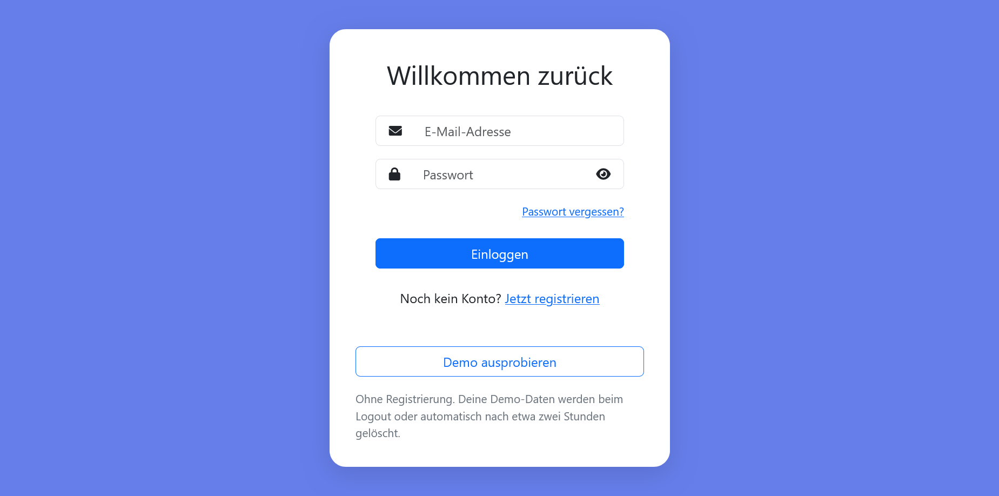
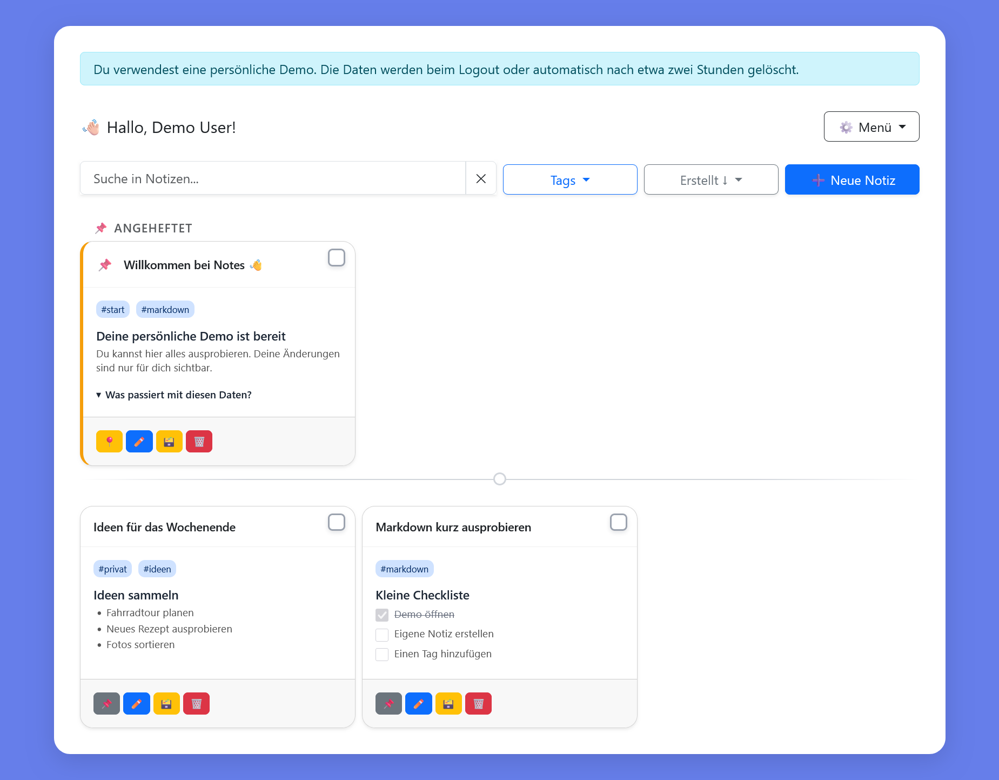
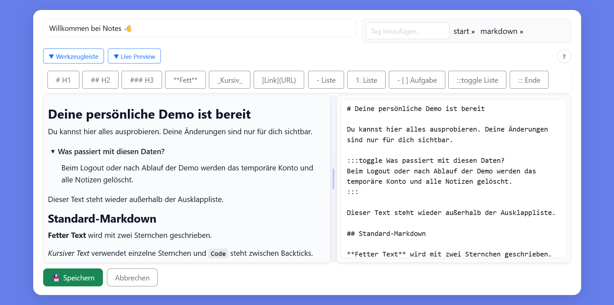
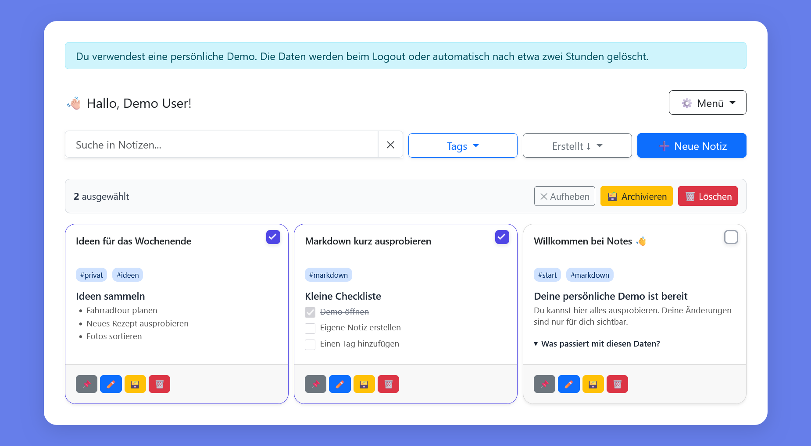

# Notes

Eine responsive Webanwendung zum Erstellen und Organisieren persönlicher Notizen. Notes verbindet eine serverseitig gerenderte Spring-Boot-Oberfläche mit Markdown-Unterstützung, Tags, Suche sowie Archiv und Papierkorb.

## Funktionen

- Registrierung und Anmeldung per E-Mail
- Notizen erstellen, bearbeiten und als Markdown in einer Live-Vorschau anzeigen
- Aufgabenlisten direkt in der Vorschau abhaken
- Notizen mit bis zu zehn Tags strukturieren
- Volltextsuche, Tag-Filter, Sortierung und Seitennavigation
- Wichtige Notizen anheften
- Mehrere Notizen gesammelt auswählen und bearbeiten
- Notizen archivieren, in den Papierkorb verschieben, wiederherstellen oder endgültig löschen
- Responsive Oberfläche auf Basis von Bootstrap und Thymeleaf

## Tech-Stack

| Bereich               | Technologie                                                  |
|-----------------------|--------------------------------------------------------------|
| Backend               | Java 21, Spring Boot 3.5.15, Actuator                        |
| Web                   | Spring MVC, Thymeleaf, JavaScript, Bootstrap 5.3.8           |
| Sicherheit            | Spring Security, BCrypt                                      |
| Persistenz            | Spring Data JPA, PostgreSQL 16                               |
| Migrationen           | Flyway                                                       |
| Mapping & Boilerplate | MapStruct, Lombok                                            |
| Tests                 | JUnit 5, Spring Boot Test, Spring Security Test, MockMvc, H2  |
| Betrieb               | Docker, Docker Compose, Render                               |

## Anwendung direkt ausprobieren

Der schnellste Weg, Notes zu testen, ist die bereits bereitgestellte Webanwendung – ohne Installation oder lokale Einrichtung:

### [Notes-Webanwendung öffnen →](https://notes-web-6zb2.onrender.com)

Einfach ein eigenes Konto registrieren und direkt Notizen erstellen, Markdown verwenden, Aufgaben abhaken sowie Suche, Tags, Archiv und Papierkorb ausprobieren.

Die Anwendung läuft auf Render und verwendet eine PostgreSQL-Datenbank von Neon.

## Screenshots

| Einstieg | Notizübersicht |
|----------|----------------|
|  |  |

| Markdown-Editor | Mehrfachauswahl |
|-----------------|-----------------|
|  |  |

Weitere Ansichten wie Dark Mode, Archiv, Papierkorb, Einstellungen und Registrierung liegen unter [`docs/screenshots`](docs/screenshots).


## Lokal mit Docker starten

Voraussetzung ist eine aktuelle Installation von Docker mit Docker Compose.

```bash
docker compose up --build
```

Anschließend ist die Anwendung unter [http://localhost:8080](http://localhost:8080) erreichbar. Beim ersten Start legt Flyway das Datenbankschema automatisch an. Ein Benutzerkonto kann direkt über die Registrierungsseite erstellt werden.

Container stoppen:

```bash
docker compose down
```

Die PostgreSQL-Daten bleiben dabei im Volume `postgres_data` erhalten.

## Lokale Entwicklung

Benötigt werden:

- JDK 21
- Docker (für PostgreSQL)

Zuerst nur die Datenbank starten:

```bash
docker compose up -d postgres
```

Danach die Anwendung mit dem Entwicklungsprofil ausführen:

PowerShell:

```powershell
$env:SPRING_PROFILES_ACTIVE = "dev"
.\mvnw.cmd spring-boot:run
```

macOS/Linux:

```bash
SPRING_PROFILES_ACTIVE=dev ./mvnw spring-boot:run
```

Die Entwicklungsdatenbank läuft auf Port `5433`. Das `dev`-Profil enthält passende lokale Standardwerte für die mitgelieferte Docker-Datenbank. `DB_URL`, `DB_USERNAME` und `DB_PASSWORD` können bei Bedarf über Umgebungsvariablen überschrieben werden.

## Tests

Die Tests verwenden H2 und benötigen keine laufende PostgreSQL-Instanz.

PowerShell:

```powershell
.\mvnw.cmd test
```

macOS/Linux:

```bash
./mvnw test
```

Die Testsuite umfasst Unit-, Repository-, MVC- und End-to-End-Tests für die wichtigsten Notiz-Workflows.

## Konfiguration

Die Anwendung verwendet Spring-Profile:

| Profil | Zweck                | Datenbankkonfiguration                                 |
|--------|----------------------|--------------------------------------------------------|
| `dev`  | Lokale Entwicklung   | PostgreSQL mit überschreibbaren lokalen Standardwerten |
| `test` | Automatisierte Tests | H2 In-Memory-Datenbank                                 |
| `prod` | Produktivbetrieb     | PostgreSQL ausschließlich über Umgebungsvariablen      |

Das `prod`-Profil erwartet zwingend folgende Variablen; im `dev`-Profil sind sie optional:

| Variable      | Beschreibung                      |
|---------------|-----------------------------------|
| `DB_URL`      | JDBC-URL der PostgreSQL-Datenbank |
| `DB_USERNAME` | Datenbankbenutzer                 |
| `DB_PASSWORD` | Datenbankpasswort                 |

Eine Vorlage befindet sich in [`.env.example`](.env.example). Spring Boot lädt diese Datei nicht automatisch. Die Werte müssen über die Shell, die Run-Konfiguration der IDE oder Docker Compose gesetzt werden. Echte Zugangsdaten gehören nicht ins Repository.

## Demo-Daten beim Deployment

Auf der Loginseite kann ohne Registrierung eine persönliche Demo gestartet werden. Für jeden Aufruf wird ein eigener temporärer Benutzer mit fünf Beispielnotizen erzeugt und automatisch angemeldet. Andere Besucher sehen dessen Änderungen nicht.

Beim regulären Logout werden Benutzer und Notizen sofort gelöscht. Wird der Browser nur geschlossen, entfernt ein regelmäßiger Cleanup abgelaufene Demo-Konten. Der Cleanup läuft zusätzlich vor jeder neuen Demo-Erstellung, damit er auch nach einer Ruhephase des Render-Dienstes zuverlässig greift.

| Variable                | Erforderlich | Standardwert | Beschreibung                         |
|-------------------------|--------------|--------------|--------------------------------------|
| `DEMO_ACCOUNT_LIFETIME` | nein         | `PT2H`       | Lebensdauer eines Demo-Kontos        |
| `DEMO_CLEANUP_INTERVAL` | nein         | `PT15M`      | Abstand zwischen Cleanup-Durchläufen |
| `DEMO_MAX_ACCOUNTS`     | nein         | `50`         | Maximale gleichzeitige Demo-Konten   |

Die Zeitwerte verwenden das ISO-8601-Dauerformat, beispielsweise `PT30M` für 30 Minuten oder `PT4H` für vier Stunden. Für Render sind keine zusätzlichen Variablen erforderlich, solange die Standardwerte passen.

Ohne aktives Profil wird nur `application.yml` geladen. Da dort bewusst keine Datenbank-Zugangsdaten definiert sind, bricht die Anwendung beim Start ab. Dadurch kann ein vergessenes Produktionsprofil nicht unbemerkt auf lokale Standardwerte zurückfallen.

## Projektstruktur

```text
src/
├── main/
│   ├── java/com/melina/notes/
│   │   ├── controller/   # Seiten- und API-Endpunkte
│   │   ├── service/      # Anwendungslogik
│   │   ├── repository/   # Datenbankzugriff
│   │   ├── entity/       # JPA-Entitäten
│   │   └── security/     # Authentifizierung und Autorisierung
│   └── resources/
│       ├── db/migration/ # Flyway-Migrationen
│       ├── static/       # CSS, JavaScript und Bilder
│       └── templates/    # Thymeleaf-Templates
└── test/                 # Unit-, Integrations- und E2E-Tests
```

## Build

Ein ausführbares JAR lässt sich mit dem Maven Wrapper erstellen:

```powershell
.\mvnw.cmd clean package
```

Das Ergebnis liegt anschließend unter `target/`. Das mehrstufige `Dockerfile` baut die Anwendung mit Maven und startet sie in einem schlanken Java-21-Container.
